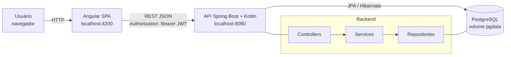
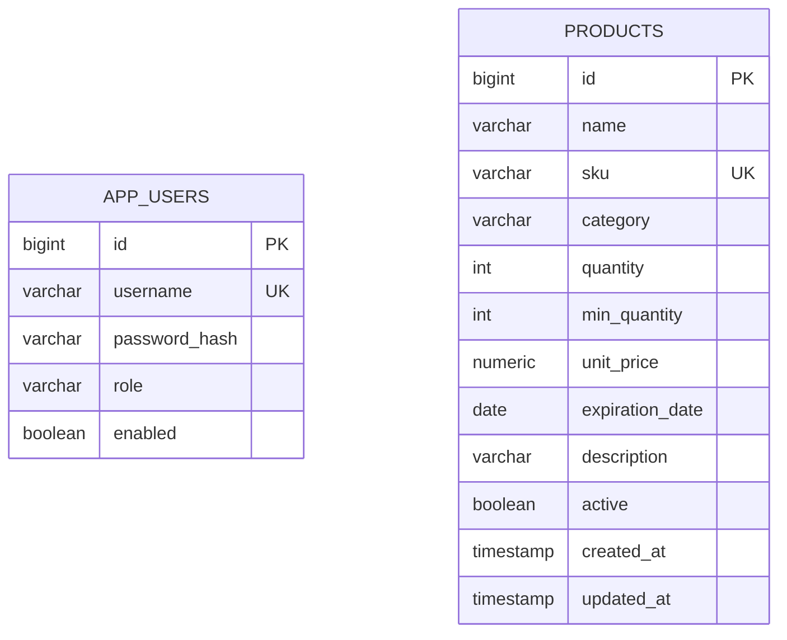
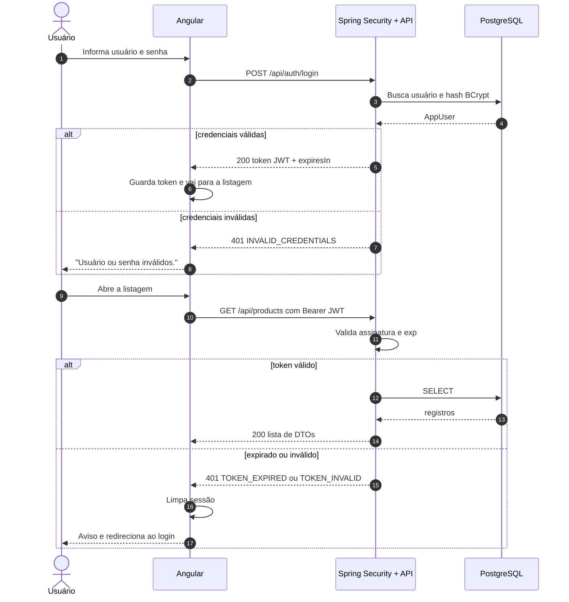
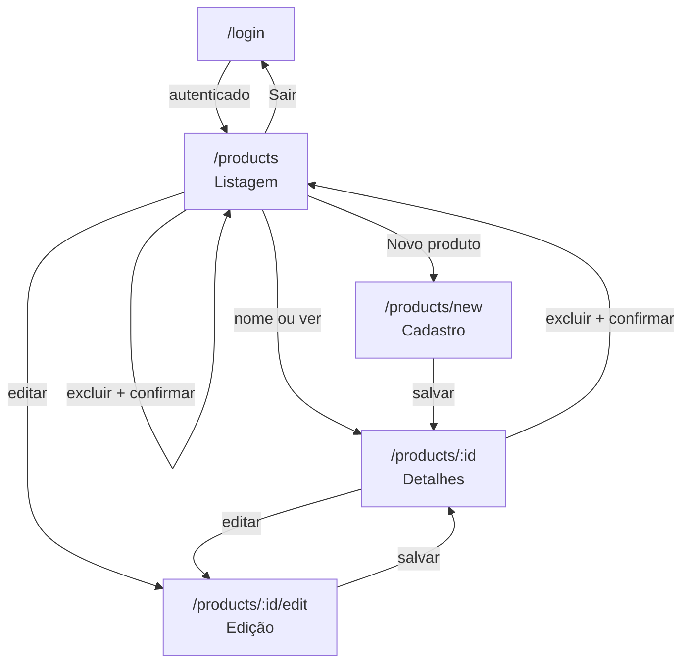
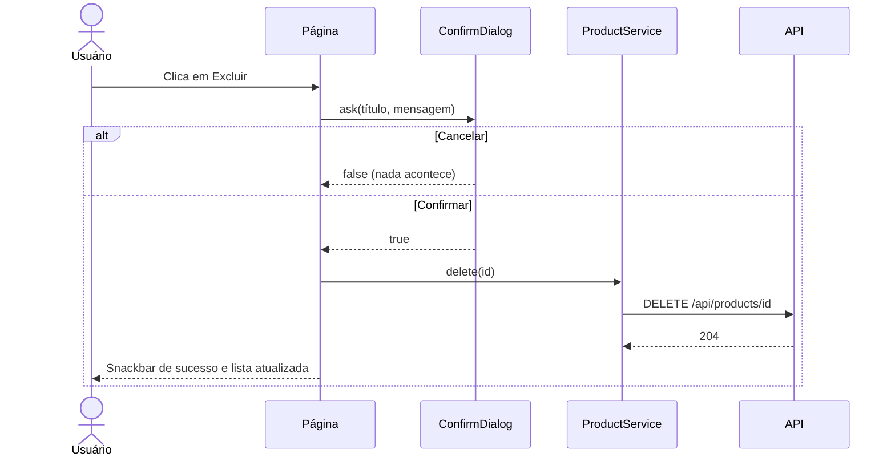
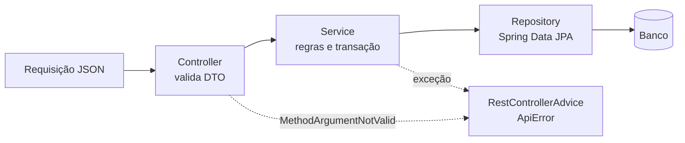

# Modelos de diagramas Mermaid

Adapte nomes e campos ao projeto real. Mantenha a sintaxe simples: caracteres acentuados em rótulos entre aspas, sem parênteses soltos em rótulos de nós (use aspas). Se possível, valide a sintaxe (por exemplo com `npx @mermaid-js/mermaid-cli`), ou ao menos releia: um erro de sintaxe quebra a renderização do diagrama inteiro.

## 1. Arquitetura (componentes)

## 2. Modelo entidade-relacionamento

Sem relacionamento entre as duas tabelas, explique no texto por quê (nesta versão o registro não guarda o autor). Se houver vínculo (por exemplo `created_by`), desenhe a relação `APP_USERS ||--o{ PRODUCTS : cria`.

## 3. Sequência do login e de uma requisição protegida

## 4. Navegação entre páginas

## 5. Fluxo de exclusão com confirmação (opcional, bom para a seção de frontend)

## 6. Camadas do backend (opcional)

